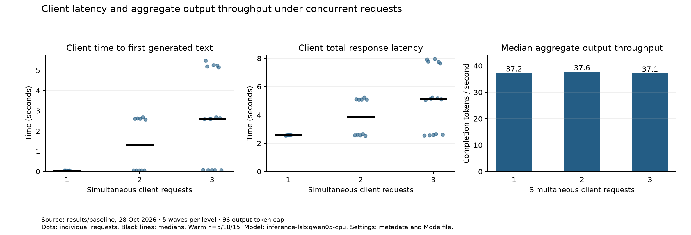
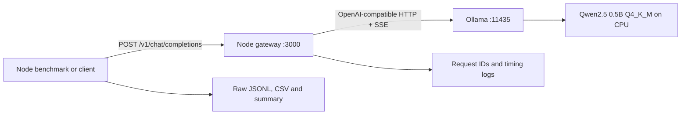

# My first model serving gateway

A small Node.js gateway, a real CPU inference experiment, and an engineering article about what changes when serving models becomes an infrastructure problem.

**Measured on an 8 GB Windows laptop, without a dedicated GPU.** This repository contains no GPU, vLLM or Kubernetes deployment results.

- [Read the technical article](docs/blog.md)
- [Inspect the experiment method](docs/experiments.md)
- [Review the raw requests](results/baseline/requests.jsonl), [CSV](results/baseline/requests.csv) and [computed summary](results/baseline/summary.json)
- [Study the production infrastructure concepts](docs/learning-notes.md)

## What happened

Warm median TTFT increased from **60.6 ms** with one simultaneous client request to **2,615.5 ms** with three. Median aggregate output throughput stayed near **37 tokens/second**. Ollama was explicitly configured with one inference slot; three accepted HTTP streams did not create three inference slots.



The measured streaming run contains **32 requests**, including **30 warm requests**, across five waves at each concurrency level. Every request generated 96 tokens and completed successfully. This is a closed-loop microbenchmark with small samples, not a production capacity estimate.

## Architecture



The gateway forwards the backend's SSE stream with backpressure, parses a copy for timing, aborts upstream work on disconnect or deadline, and rejects excess inflight work with HTTP 429. It has no runtime npm dependencies.

Supported API subset: text chat completions, streaming and nonstreaming responses, `model`, `messages`, `max_tokens`, `temperature`, and `seed`. `GET /v1/models`, `/healthz`, and `/readyz` are also provided. This is not the entire OpenAI API. Tools, image input, embeddings and Responses are outside this gateway's scope. Other request fields are ignored by the explicit allowlist.

Readiness checks backend reachability and model registration. It does not preload the model or guarantee a warm response.

## Reproduce on Windows

Prerequisites: Node.js 22+, PowerShell, and Ollama. Installation instructions are in [Ollama's docs](https://docs.ollama.com/windows).

```powershell
ollama pull qwen2.5:0.5b
npm test
./scripts/start-lab.ps1
node scripts/chat.mjs "Explain what a model serving gateway does."
./scripts/run-experiments.ps1 -ResultsDirectory results/my-run
node bench/summarize.mjs results/my-run
node scripts/verify-evidence.mjs results/my-run
./scripts/stop-lab.ps1
```

No `npm install` is required. If PowerShell blocks local scripts, run the equivalent Node commands and start Ollama manually as described in [the experiment method](docs/experiments.md); no execution-policy change is needed.

The launcher starts an isolated Ollama server on loopback port **11435** with `OLLAMA_NUM_PARALLEL=1`, a 2048-token context and a five-minute keep-alive. It creates the model from `Modelfile`, which selects four CPU threads and `num_gpu=0`. Your normal Ollama server can remain on port 11434. It starts the gateway on loopback port **3000**, with a maximum of three inflight requests and a 120-second deadline.

Do not run another inference client during measurement. Close unnecessary desktop applications and record any changes to the environment. The run refuses to overwrite an existing request file.

On other operating systems, start Ollama and Node with the same environment variables; Windows host sampling scripts will need replacing. `bench/run.mjs` and the gateway themselves use portable Node APIs.

## Results and figures

The saved baseline records Node v22.13.1, Ollama 0.40.12, the model digest and quantization, prompts and their SHA-256 hashes, raw responses, token counts, timestamps, CPU samples, and model residency. `size_vram=0` in the saved model residency response confirms CPU placement. `node scripts/verify-evidence.mjs results/baseline` checks request completeness, wave counts, prompt hashes, request IDs and the computed summary.

To recreate figures, install the optional plot dependencies in your own Python environment, then run:

```powershell
python -m pip install -r scripts/requirements-plot.txt
python scripts/plot.py results/baseline
```

Plotting is optional and is not needed for the server, tests or experiments.

## Scope and next experiment

This is a local learning gateway. Authentication, tenant isolation, TLS termination, distributed quotas, persistent metrics, and multi-replica admission control would be required before exposing it as a production service. Binding to loopback is the default.

The same request shape can be sent to a vLLM backend by changing the upstream URL and model name. The [migration notes](docs/learning-notes.md#next-experiment-vllm) describe that untested next step. The Ollama-specific cold-start control and native timing probes in this benchmark harness must be replaced when testing vLLM.

## Project checklist

- [x] Implement OpenAI-compatible text chat and SSE streaming.
- [x] Verify error handling, deadlines, cancellation and concurrency admission.
- [x] Measure CPU inference, cold/warm requests, TTFT, latency and concurrency.
- [x] Save reproducible configuration and raw evidence.
- [x] Write architecture, study notes, findings, limitations and article.
- [ ] Human review of the article and answers to the study questions.
- [ ] Publish the article on the author's chosen platform and share it on X.

The reading notes document source material; they are not a claim that the author has deployed the production systems discussed.
