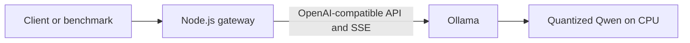
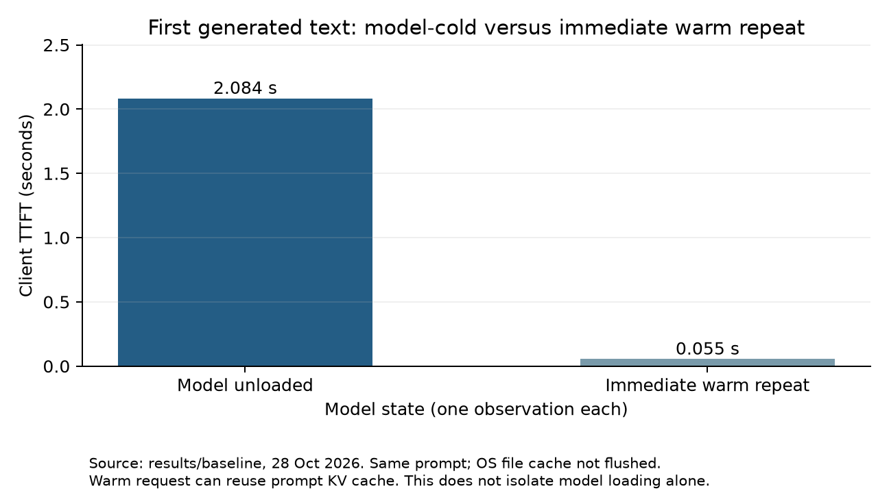

# How LLM Inference Works in Practice: Building My First Model Serving Gateway

I wanted to understand what happens between sending a prompt and seeing an answer. I had an 8 GB Windows laptop with a Ryzen 3 processor and integrated Radeon graphics. That was enough to build a small model service and measure its behavior.

The most useful result came from sending three requests at once. The HTTP server handled all three, but the model did not start generating all three answers together. One client saw text quickly. The others waited. Aggregate output throughput barely changed.

That difference between accepting requests and executing inference became the main lesson of the project.

## A small model behind a familiar API

I used Ollama 0.40.12 to run `qwen2.5:0.5b`, a roughly 494-million-parameter model in Q4_K_M quantization. Its download was about 397 MB. My configuration forced CPU inference, selected four threads, and limited context to 2048 tokens. The saved model residency response reported zero VRAM use.

The model was deliberately small. The purpose was to observe serving behavior within this laptop's memory budget, not to demonstrate the best available model quality.

The request path was:

The gateway exposes `/v1/chat/completions` and forwards a restricted text-chat request to Ollama's compatible endpoint. Streaming responses use Server-Sent Events. I also added request IDs, a deadline, a limit on inflight requests, and cancellation of upstream work when a client disconnects.

The protocol matters because it creates a useful boundary. [Ollama](https://docs.ollama.com/api/openai-compatibility) and [vLLM](https://docs.vllm.ai/en/latest/serving/online_serving/) both expose compatible chat APIs. Moving this gateway to another backend can preserve the client's basic request shape. It still requires checking model names, chat templates, usage reporting and supported parameters.

The gateway does not tokenize prompts or run the model. Those jobs remain in the inference backend.

## Measuring the first text, not just the first response

For each streamed request, I measured time from immediately before the client's HTTP call until the first nonempty text delta. An HTTP response header or an event announcing the assistant's role did not count as generated text.

That distinction affected the implementation. A network chunk is not necessarily an SSE event, and an SSE event is not necessarily one model token. The parser handles events and UTF-8 characters split across network chunks. Token counts come from the backend's final usage response, rather than counting chunks or estimating from text length.

I recorded total response latency as well. For throughput, I summed the completion tokens in a wave and divided by that wave's actual elapsed time. Summing individual clients' tokens-per-second figures would give a different and misleading aggregate.

The run included five waves at each of three concurrency levels, plus a model-cold request and an immediate warm repeat: 32 measured streamed requests in total. All generated 96 tokens and reached the output cap. The order of concurrency levels rotated between rounds. This was a closed-loop experiment: each wave finished before the next began.

## Three clients increased waiting time

With **one** simultaneous request, median TTFT was **60.6 ms** and median total latency was **2.582 seconds**. Median aggregate output throughput was **37.18 tokens/second**.

With **two**, median TTFT was **1.319 seconds** and median total latency was **3.866 seconds**. Aggregate output stayed at **37.65 tokens/second**.

With **three**, median TTFT reached **2.615 seconds** and median total latency reached **5.152 seconds**. Aggregate output was **37.07 tokens/second**. There were no failed requests.

The individual timings explain more than the medians. In the first three-client wave, first text arrived after about **84 ms**, **2.60 seconds**, and **5.48 seconds**. Requests were waiting for an inference slot.

I had explicitly set `OLLAMA_NUM_PARALLEL=1`. Node could keep three HTTP requests in flight, and the gateway permitted that load, but Ollama had one generation slot. Increasing client concurrency mostly increased waiting time in this configuration. It did not increase the engine's processing capacity.

This does not mean Ollama always serializes requests. It describes the configuration I actually ran. A useful next experiment would change engine parallelism while holding the workload fixed.

## The first request paid for more than decoding

After unloading the model, the first streamed request took **2.084 seconds** to produce text. Repeating the same prompt immediately reduced that to **55 ms**. Full response latency fell from **4.532 seconds** to **2.587 seconds**.

It would be tempting to call that entire difference “model loading.” The native Ollama timings show why that would be too simple.

I collected a separate cold/warm pair through the native API. The cold probe reported **1.407 seconds of load time** and **0.634 seconds of prompt evaluation**. The warm probe reported **0.010 seconds of load time** and **0.063 seconds of prompt evaluation**. It also reported **68 of 69 prompt tokens cached**, compared with zero cached tokens in the cold probe.

Both residency and prompt-cache reuse changed. Those probes support that explanation, but they do not precisely decompose the earlier streamed timings. I also did not flush Windows' filesystem cache, so “cold” here means the model was unloaded from Ollama, not a fully cold machine.

The native decoder rates were about **35.55** and **33.70 tokens/second**. Those measure only the engine's decode phase. They should not be compared directly with an end-to-end client rate that includes waiting and prompt processing.

## What this taught me about production infrastructure

Reading about inference infrastructure became easier once I had a concrete queue and a cold model to think about.

**vLLM sits behind the API boundary.** Its [PagedAttention article](https://vllm.ai/blog/2023-06-20-vllm) describes managing the attention KV cache in blocks to reduce wasted memory and accommodate more active sequences. Continuous batching concerns which sequences the engine executes as generation proceeds. It is different from letting Node accept concurrent HTTP connections. I did not run vLLM or measure GPU batching here.

**Kubernetes places workloads onto available hardware.** With the device-plugin approach, a GPU becomes a schedulable resource such as `nvidia.com/gpu`. Selecting a suitable node still requires understanding the model's memory needs. A request for one GPU does not describe the amount of KV cache a workload will need. [Kubernetes GPU scheduling](https://kubernetes.io/docs/tasks/manage-gpus/scheduling-gpus/)

**The NVIDIA GPU Operator manages the node's GPU software stack.** That includes components such as drivers, the container toolkit, the device plugin and monitoring. It solves a different operational problem from the model server. [GPU Operator overview](https://docs.nvidia.com/datacenter/cloud-native/gpu-operator/latest/overview.html)

**Monitoring needs both device and service measurements.** [DCGM Exporter](https://docs.nvidia.com/datacenter/dcgm/latest/installation/install-dcgm-exporter.html) provides NVIDIA telemetry in Prometheus format. On a GPU service I would correlate device utilization and memory with TTFT, queueing and throughput. This project collected Windows process samples instead: inference processes used a median **49.1% of the machine's eight logical CPUs** across 93 intervals, consistent with the four configured threads being busy. Running entirely on CPU does not, by itself, prove whether arithmetic or memory bandwidth was the limiting resource.

**KServe addresses the serving lifecycle above an individual engine.** Its control plane and pluggable runtimes help manage model services, replicas and operational policies. An engine still schedules sequences within a replica. The cold/warm difference also makes readiness and warm capacity concrete: a process being alive does not mean a model is ready to answer quickly. [KServe overview](https://kserve.github.io/website/docs/intro)

These are connections drawn from the documentation. I did not deploy Kubernetes, the GPU Operator, DCGM or KServe on this machine.

## What I would change next

First, I would run the same workload with another Ollama parallelism setting. That would separate the effect of the chosen scheduler configuration from the laptop's overall capacity.

Then I would move to vLLM on a supported cloud GPU and record the exact hardware, engine version, precision, context and scheduling settings. The current benchmark's Ollama-specific unload and native-timing calls would need replacing. A default floating-point vLLM model would also differ from this quantized GGUF model, so I would disclose that difference before comparing numbers.

I would test longer prompts, longer answers and an open-loop arrival rate, then collect enough samples to investigate tail latency. Five waves per concurrency level are useful for seeing this queueing pattern; they are insufficient for a production p99 claim.

Finally, speed needs a quality check. The tiny model's saved response gave a confused explanation of prefill. Successful streaming and a respectable token rate do not make its answer correct. These results measure serving behavior, not whether the model is suitable for a particular application.

The repository includes the gateway, tests, prompts, configuration, raw request records, native timings and figure-generation script. Another person can rerun the experiment and inspect how each published number was obtained.
